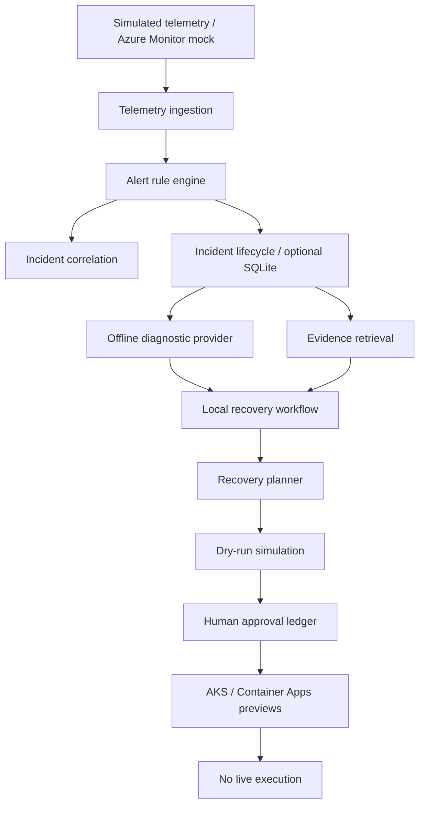

# Autonomous Cloud Ops

**Offline-first .NET 10 portfolio project for cloud observability, incident response, AI-ready diagnostics and human-governed recovery planning.**

[](https://github.com/alwayskrishna/autonomous-cloud-ops/actions/workflows/ci.yml)

This project demonstrates C#/.NET backend engineering, distributed-systems concepts, operational observability, incident lifecycle management, and safety-first automation. The primary experience runs locally with mock providers; **no Azure subscription or paid cloud services are required**.

## Hiring-manager quick tour

This repository is a **local/offline portfolio demonstration**, not a deployed self-healing cloud service. To evaluate the engineering design, start with:

1. [Architecture](docs/architecture.md) for component boundaries and tradeoffs.
2. [Guided demo](docs/demo.md) for simulated telemetry, incident correlation, and dry-run recovery.
3. [Runbooks](docs/runbooks.md) for operational decision-making.
4. [Security and tenant limitations](docs/tenant-security.md) for what is and isn't protected in the prototype.

**Run and test quickly** using the .NET SDK commands below. No subscription is required, and recovery actions never change infrastructure.

## Quick start

Requires the .NET 10 SDK.

```bash
dotnet run --project src/AutonomousCloudOps.Cli/AutonomousCloudOps.Cli.csproj
dotnet test tests/AutonomousCloudOps.Tests/AutonomousCloudOps.Tests.csproj -c Release
dotnet test tests/AutonomousCloudOps.Api.Tests/AutonomousCloudOps.Api.Tests.csproj -c Release
```

The CLI generates simulated CPU, memory and HTTP-error telemetry, detects and correlates incidents, and prints incident lifecycle history.

Optional localhost-only API container:

```bash
docker compose up --build -d
curl http://127.0.0.1:8080/health
docker compose down
```

The API is **not authenticated** and must not be exposed publicly.

## Architecture



The diagram shows component relationships, not an automatically executing pipeline. Some capabilities are available through separate APIs or library calls and are not wired together end-to-end.

## Implemented capabilities

| Area | Implementation | Current boundary |
| --- | --- | --- |
| Detection | Configurable metric alert rules, simulated ingestion | Synthetic/offline data |
| Incidents | Correlation, state transitions, audit history | Optional SQLite persistence for incidents |
| Observability | OpenTelemetry-compatible activities and metrics | No production collector configured |
| Diagnostics | Mock AI-ready provider and evidence retrieval | Deterministic guidance, not an LLM |
| Tools | Local MCP-style diagnostic tool registry | Not a protocol-compliant MCP server |
| Recovery | Action contracts, dry runs, approval/rejection audit | No infrastructure execution |
| Orchestration | In-process incident recovery workflow | Not an Azure Durable Functions host |
| Platform adapters | AKS and Container Apps descriptive previews | No Azure/Kubernetes SDK calls |
| Security | Tenant policy and scoped incident-store prototype | Existing HTTP API remains unauthenticated |
| Deployment | Local Docker Compose and zero-resource Bicep scaffold | No Azure provisioning |
| Resilience | Bounded retry helper, tests and offline benchmark | Not an end-to-end production SLO |

## Guided walkthrough

See [the demo](docs/demo.md) for an offline scenario and API examples. [Architecture](docs/architecture.md) explains design tradeoffs. [Runbooks](docs/runbooks.md) cover incident triage and safe recovery review.

For performance exploration:

```bash
dotnet run --project benchmarks/AutonomousCloudOps.Benchmarks/AutonomousCloudOps.Benchmarks.csproj -c Release -- 10000
```

## Engineering tradeoffs and next steps

- **Safe by default:** all recovery proposals and platform previews are non-executing; approvals never mutate infrastructure.
- **Testability:** provider interfaces and mocks allow local evaluation without subscriptions.
- **Known gaps:** authenticated tenant-aware HTTP APIs, durable orchestration and approvals, real MCP transport, production telemetry connectors, resource discovery, secure cloud deployment, and production-grade resilience policies remain future work.

This repository is an engineering demonstration, **not a production-ready autonomous remediation service**. See [deployment precautions](docs/deployment.md) and [security limitations](docs/tenant-security.md).

## Repository layout

`src/AutonomousCloudOps.Core` — domain logic and abstractions

`src/AutonomousCloudOps.Api` — local incident and recovery API

`src/AutonomousCloudOps.Cli` — offline demo

`tests/` — unit and integration tests

`benchmarks/` — synthetic load benchmark

`infra/` — non-provisioning Bicep scaffold

`docs/` — design, safety guidance and runbooks
